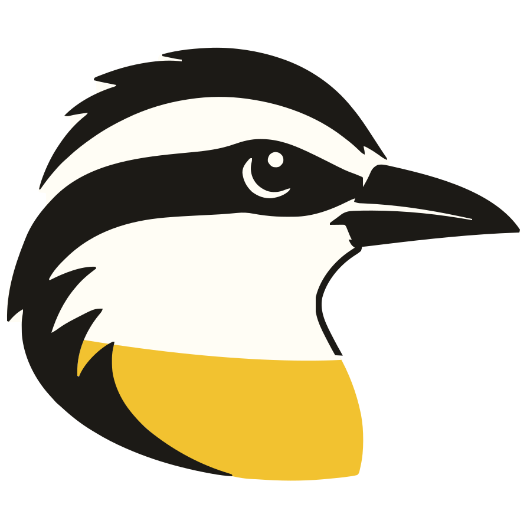

English · [Español](es/marca.md)

# Pitangus brand: name, logo, colors and voice

How Pitangus looks and speaks, for anyone writing about it, contributing to the panel or the reports, or building
something next to it. The source of truth is the identity manual in
[`.claude/skills/pitangus-brand`](../.claude/skills/pitangus-brand/SKILL.md): every color with its one meaning, in
light and dark ([`tokens.json`](../.claude/skills/pitangus-brand/tokens.json)), type, spacing, radii, components and
what's prohibited. The panel implements those tokens in `web/src/index.css`, the PDF and Markdown reports in
`pitangus/modules/reporting/design.py`. When this page and the manual differ, the manual wins.

## Name

**Pitangus** is the great kiskadee (*Pitangus sulphuratus*), the bird Colombians call **bichofué**. It perches still on
a branch, watches everything that moves and catches bugs of every kind, in the air or on the ground; it's small and
still takes on hawks far bigger than itself. That's what we want to be for small teams: watch every change, catch
what's wrong and show it's gone.

The brand is written **Pitangus**. The technical name is also `pitangus`: package, CLI, `PITANGUS_*` variables,
images, container and the GitHub commit status. The GitHub repository is `pitangus`, in the `Pitangus-Dev`
organization. Pitangus is made in Colombia by **Arodium**.

## Logo

The kiskadee's head in profile: the black crown and mask, the white brow, the black bill and a sulphur-yellow breast.
Its outline is ink, so it has two forms:

| File | Use |
| --- | --- |
| `web/public/assets/pitangus-logo.svg` (copy: [`assets/pitangus.svg`](assets/pitangus.svg)) | The head alone, **on light grounds only** (`bg`, `surface`). On a dark ground its ink outline vanishes and leaves the brow floating. |
| `web/public/assets/pitangus-icon.svg` (also `favicon.svg`) | The head on its stone tile (`#F5F6F7`): the favicon, the app avatar and **every dark ground**. |

In the panel the mark is drawn by `web/src/shared/ui/brand-mark.tsx`; in the sidebar it sits on its tile at the top.

- Use the files as they are: don't redraw, stretch, rotate or recolor them.
- Minimum size: 24 px. The favicon is the only use below that.
- Next to the name: the logo on the left and "Pitangus" in IBM Plex Sans semibold.

## Color

Pitangus uses **cool neutrals**: a cool stone page (`bg`) and white surfaces, never cream. Every color means one thing,
and a color used for two roles means one of them is wrong.

### Neutrals and brand

| Token | Light | Dark | Use |
| --- | --- | --- | --- |
| `bg` | `#F5F6F7` | `#111315` | Page background, cool stone. |
| `surface` | `#FFFFFF` | `#181B1E` | Tables, dialogs, menus, charts. |
| `sunken` | `#ECEEF1` | `#202428` | Inputs, hovered and selected rows, a selected chip. |
| `line` | `#DADDE1` | `#2C3136` | Hairlines: table rules, section dividers. |
| `ink` | `#16181B` | `#ECEEF0` | Text and headings; links (underlined). |
| `muted` | `#5C636B` | `#9AA1A9` | Captions, labels, metadata (≥ 4.5:1 in both themes). |
| `sulphur` | `#F2C230` | `#F2C230` | **The brand and the primary action only**, with `on-sulphur` (`#16181B`) text. |
| `rufous` | `#9C4A1E` | `#C9764A` | The kiskadee's wing: illustration only, never UI text, links or focus. |
| `focus` | `#16181B` | `#F2C230` | Keyboard focus ring: 2px solid with a 2px offset. |

**Sulphur means "do the main thing".** The header's **New scan**, a form's or dialog's primary action and an empty
state's call to action are solid sulphur, at most one per zone. Everything else is an outline or ghost button. Sulphur
is never a status, a severity, a pale button or a selection tint.

### States

Each state has a family of three tokens: text, soft background and border. Severity is drawn from them, always with
its word next to it, never by color alone.

| Family | Light text | Dark text | Means |
| --- | --- | --- | --- |
| `critical` | `#B42318` | `#FF8B7B` | Failure, errors, Critical and High severity, KEV. Critical is a solid chip with white text. |
| `attention` | `#9E4708` | `#F5A35C` | Medium severity, partial runs, due soon, half-done setup. **Orange, never yellow.** |
| `ok` | `#1E7444` | `#5CC98A` | Completed, connected, fixed, verified. |
| `info` | `#2D5A87` | `#8DB4DD` | Low severity, running, queued, neutral notices. |

An informative notice is a row on the normal surface with the status icon in its color; only an error that blocks the
task gets the `critical` soft background and border. Charts use the same families; a single series is neutral grey.
Everything is checked for WCAG AA contrast in both themes.

### The sidebar: the kiskadee's crown

The app's frame carries the identity, not the data. The sidebar is `chrome`, near-black ink in both themes (`#16181B`
light, `#0B0C0E` dark), with light text, and the active item in sulphur on a raised ground. Header and content stay on
`bg` and `surface`. Nothing else in the panel uses `chrome`.

## Type

**IBM Plex Sans** for everything and **IBM Plex Mono** for code, in the panel and the reports (the PDF reports also set
titles and running prose in Source Serif 4). Monospace is only for code, paths, hosts, rule ids, CVEs and versions.

| Style | Size / line height | Use |
| --- | --- | --- |
| `page-title` | 24/30, semibold | A page's title, once per view. |
| `section-title` | 16/24, semibold | A section or dialog heading. |
| `body` | 14/22 | Default text and table cells. |
| `small` | 13/20 | A row's secondary line. |
| `caption` | 12/16 | Figure labels, column headers, hints. Sentence case, never uppercase. |
| `code` | 13/20, mono | Code and identifiers only. |

## Space, radii and shadows

- Spacing in 4px steps: 24px between page sections, 16px inside tables and dialogs.
- Radii: 4px for badges and chips, 6px for buttons, fields and menus, 8px for tables, dialogs and charts. Nothing
  rounder; fully round only for status dots, radios and switches.
- Shadows only on what floats: menus and popovers, dialogs and the command palette. Flat surfaces have none.

A page is structure before boxes: title, one line of description, toolbar, content, full width and left aligned. Tables
with a hairline border, sections split by a rule. A card only for a chart or a self-contained object; never a card
wrapping the page or a card inside a card.

## Icons

[Phosphor](https://phosphoricons.com/) icons (MIT), regular weight, 16px (20px in navigation), in the color of the text
beside them, only where they carry meaning. One concept, one icon: scanning is always `Scan`, never a "play" icon; AI
never gets a sparkle.

## Voice

Direct, without fear or alarmism: we say what's happening, why it matters and how to fix it. In English: plain, second
person, active voice. In Spanish: neutral Latin American Spanish, *tú*. Each language is written for its own readers,
not translated from the other (see [`.claude/skills/pitangus-i18n/SKILL.md`](../.claude/skills/pitangus-i18n/SKILL.md)).

- Short sentences and concrete verbs ("Add domain", "Start scan"); a button and its confirmation use the same word.
- Name what people recognize (domain, test user, scope), never internal names.
- Errors say what happened and how to continue, without apologies.
- A finding's fix is the tool's own text plus its OWASP guidance: Pitangus never invents remediation.
- Negative results don't prove absence: say when something wasn't checked ("not tested", "partial coverage").
- No emoji, no exclamations, no slogans inside the panel.

Outside the panel:

- Headline: **"Watch every change. Prove every fix."** (in Spanish, **«Vigila cada cambio. Demuestra cada corrección.»**).
- Tagline: **"Spot it. Fix it. Prove it."** (in Spanish, **«Detéctalo. Corrígelo. Demuéstralo.»**).

"Prove" means evidence: the finding no longer reproduces when the same analysis runs again. It's not a guarantee that
there are no vulnerabilities; say so wherever the claim needs nuance.

## What not to do

Pale-yellow buttons; yellow for any state; full pastel notice boxes; "play" icons for scanning; cards wrapping a page or
inside another card; grids of identical icon, title and bullet cards; radii above 8px; solid black buttons;
letter-spaced uppercase labels; monospace labels; "→" at the end of text; gradients; blurs; sparkle icons; cream
grounds.
